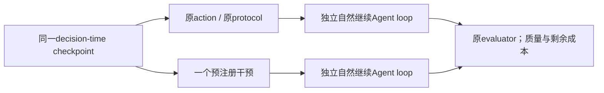

# Counterfactual Avoidability Protocol v1 — design only

2026-10-11。**没有执行本协议中的任何实验。** 不授权恢复Phase II、重跑原始cells、
调用真实模型或实现在线Optimizer。后续实验必须另行授权并创建独立namespace；
现有原始trace、result、admission、journal和freeze保持不变。

## 目标、干预和基线

从同一个干预前状态分叉：

Level1检验operator result/contract与实际减少的工作；Level2独立续跑检验最终Task
Success和完整资源vector。Level1不能替代Level2，单次成功也不构成TSR non-inferiority。
控制组必须从相同恢复边界**重新自然生成后缀**，不能拿历史后缀当作新的control执行。

干预定义：

- B-skip：跳过指定的一次非终端model action，保留所有prefix observations，
  让Agent观察明确的干预结果并自行补救；绝不注入该调用在历史中产生的输出。
  B-merge是另一策略，不能在同一pilot混入skip，须单独冻结输入/输出/预算规则。
- C-collapse：在指定Manager decision压缩一组Quote/Commit交互，提供同一时点的
  原有cost feedback与相同动作检查。不得用历史未来的quote或模型结果。
  明确哪些Manager request被免除、是否免除Verifier，并保持已使用预算和剩余budget
  的原定义；改变预算定义属于另一个干预。后续replanning费用全部计入。
- D-pushdown：只接受保持全局retrieval统计、排序/tie、内容和输出schema的改写。
  禁止默认各shard本地BM25 top-k拼接等价于全局BM25；不得以gold选择字段或documents。
- A-reuse：当前未发现有历史闭包证明的点，不安排假造的Exact pilot。以后需要
  implementation/version、effective args/defaults、有序输入内容hash/version、执行config、
  determinism及output rebinding完整证明；先Level1，再Level2。

基线采用同Planner、Verifier、operator/model配置、Physical Scheduler、benchmark adapter
和原evaluator。只改变一个指定干预，不同时做prompt tuning、model substitution、budget
extension或部署调优。新的独立Optimizer若未来被测试，必须另列成本，并保留Planner-only
同预算baseline，不预设它更好。

## 8个可追溯的初步干预点

完整trace/manifest/admission/source hashes和dependencies在opportunity dataset中，
下表event index为JSONL非空事件的**0-based索引**，是定位信息，不是可恢复状态证明。
P1=DeepSeek，P2=Qwen。成本均为原操作已测值，非预计节省。

| ID | 来源 / 状态 | 点 / 观测成本 | 干预及要回答的问题 |
| --- | --- | --- | --- |
| `aw-6e93f85e032bc211e8d6` | Phase II子集 cell15/P2/B1，score1 | event209；model796.637s | B-skip：昂贵中间推理是否被隐式使用，删后是否再次付出同等work？ |
| `aw-16b368ef328846a797ad` | Phase II子集 cell16/P1/B0，score0 | event658；model670.771s | B-skip：错误终局不表示此调用无用；观察续跑、recovery及质量变化 |
| `aw-18a9df82dac9bf38166a` | Phase I cell125/P1/D，未评估/turn exhaustion | event385；model316.683s | B-skip：是否使自然续跑到达终局，或丢失必要evidence？ |
| `aw-6fa6712448bbdb053d0b` | Phase I cell14/P1/A，score1 | event203；model293.427s | B-skip：保留成功轨迹作为质量风险对照 |
| `aw-80057887416aadaa0ce6` | Phase I cell92/LongBench/P2/D，score1 | input87/batch94；相关reasoning36.578s | C-collapse：减少一次交互是否保留反馈与合法终局？ |
| `aw-277e1c1b0a6351d38a54` | Phase I cell76/MultiHop/P1/C，未评估/turn exhaustion | input209/batch214；相关reasoning11.339s | C-collapse：是否释放控制预算，同时保持约束和Verifier语义？ |
| `aw-e1d5ec92084c9dfcbbbd` | Phase I cell20/MultiHop/P2/C，score1 | event33；5,204,596B movement | D-pushdown：先证明全局排序和完整结果等价，再测Fast/Slow净资源差 |
| `aw-43e9f8dbd11845537165` | Phase I cell13/MultiHop/P2/B，score0 | event21；5,204,596B movement | D-pushdown：保留错误样本，不能仅成功样本验证成本 |

这是一份purposive机制诊断清单，主要集中在MultiHop；不代表任务分布或全benchmark
effectiveness。C提供LongBench覆盖；Video over-expansion仍是历史诊断，不强行增加点数。
推荐最小初始pilot为两C点加前两B点，四points × control/intervention。
其余四点只在状态还原与前四点结果有信息价值后考虑，不自动扩成benchmark matrix。
不能为了执行历史点而未经授权重新生成原prefix。

## State restoration与runtime可实现边界

代码检查：`control/native_agents.py` 的 `run()` 每次创建 `_NativeState`、
`ExecutionGrownGraph`、artifact namespace、tools/hooks及bounded specialist，再直接
`runner.run(manager, input=..., context=state, max_turns=..., hooks=...)`。
当前wrapper没有接收checkpoint、SDK RunState、session、fork或resume的接口。
Verifier在 `control/verification.py` 中独立 `runner.run(..., max_turns=1)`；
图快照不包含完整SDK执行状态。旧 `adaptive_executor` 的immutable-prefix revision
是显式workflow substrate，不等同于当前persistent SDK-native Manager分叉。
这里判断的是仓库实际wrapper，不推断外部SDK所有版本的潜在能力。

最小后续能力是**quiescent decision-boundary checkpoint/restore**：

1. 在Manager model输入或tool-dispatch之前暂停，所有parallel tools/specialists已结算。
   有in-flight工作时不得假定可复制；如只能更早设barrier，应明确边界并重新注册实验。
2. 保存完整SDK conversation/call IDs、active agent、turn位置、未结算tool结果状态与
   model settings；绑定运行时、SDK lock、instructions、tool schema和execution freeze。
3. 保存 `_NativeState` 的graph及producer映射、actions、observations、planner/verifier
   steps、accessible/produced sets、handoffs、phase、全部turn/call/specialist预算计数，
   terminal/fatal flags；cost ledger、quote states/consumption/expiry和rules/history bindings。
4. 所有prefix artifacts按内容hash/version、media type、placement和schema还原到两个
   branch私有的copy-on-write Worker stores，保持逻辑ID但隔离写入与缓存。任何prefix
   输出不可重算或改写；历史私有内容只能在原owner机器内部处理。
5. 相同infra初始状态、resident model/cache/load/availability、队列和scheduler state；
   共享单device不能使两组同时争用而引入实验干预。分开运行并随机化先后，核验环境。
   wall clock、quote expiry等时钟应有明确恢复策略，两组一致，不能静默重置有效期。
6. 比较canonical state/hash和两组输入完全相同后才放行。禁止共享mutable ledger、
   quotes、Worker writes或SDK工具对象；记录branch isolation和restore validation receipts。

如SDK内部state无法完整恢复，可实现的降级边界是：在无未结算tools时，从保存的
effective conversation加显式应用checkpoint启动新SDK run；两组都从该边界重新启动，
保留absolute预算计数和相同input。必须标记为 **input-boundary restart experiment**，
先验证restart控制组与原边界的可观察状态/行为约束；不能声称恢复了原SDK因果轨迹。
如果应用state也缺失，当前只支持Level1离线contract验证；不伪造Level2。

trace中的后续observations、模型输出、private evaluator/gold/supports都不得注入prefix。
只有checkpoint之前实际产生的材料允许进入Agent；私有evaluator仅在终局后运行。
不能将本轮对最终答案的分析结果编成Agent可见优化规则。

## 成本、质量与样本设计

逐branch报告未加权resource vector：Manager、Verifier、Specialist、Inference、Network、
Operator。分别保留turns、provider requests、successful inferences、tokens、可追溯价格
估计、service work和实际wall E2E，不混合单位。GPU-seconds无可信测量时为unknown。
初始materialization、prefix sunk cost、branch restoration/setup、干预自身work和自然续跑
remaining cost单列。共享prefix不属于可节省成本，不从历史总成本减掉未执行后缀估收益。

对每对计算 `ΔC = C_control_remaining − C_intervention_remaining`，包括fallback、
replan、额外inference、cache lookup/rebinding、global stats/merge和Optimizer本身。
非可加的service/parallel work不合成为E2E；未知分量保持null并报告coverage。
本轮dataset的毛上界不替代此测量，C的enclosing reasoning work也不等于必然可免除work。

Level1：比较完整输出内容hash/schema/顺序、metadata、依赖和重绑定contract；对D检查
global stats、tie、top-k和错误路径。失败即停止该rewrite，不把“样本上恰好相同”提升成
一般等价性。Level2：原evaluator按benchmark分别统计completion、format、score及failure
type；未完成是unevaluated，不是score0。TSR对预注册的admitted tasks报告，同时单列
完整完成率与原score1；若把成功定义为完成且score1，须事先声明，不能补写失败分数。

第一轮机制pilot建议每point各branch做3个自然continuations；共8points×2×3=48branch
continuations，是未来**上限建议**，非当前执行授权，也非达到non-inferiority的样本量。
最小四points为24branch continuations；固定三次，禁止看到坏结果后追加/挑选最好一次。
若model支持seed，pair内匹配seed并记录；temperature0仍不假定完全确定。
环境恢复的setup成本单列；执行随机化control/intervention顺序，保留完整失败attempt。

正式TSR non-inferiority须在策略冻结后使用未用于本次mining和调参的held-out tasks。
Phase II已观察任务不再当成新hold-out；未启动任务也不能在本轮自动调用。
预注册每benchmark的非劣界δ、任务数/重复数、样本量计算及stopping rule。
以task为cluster，保留同task条件/重复的相关性；使用paired task-level bootstrap或
适当paired二元方法构造 `ΔTSR = TSR_intervention − TSR_control` 的置信区间。
单侧下置信界超过−δ才支持非劣；pilot成功不能替代该标准。
资源区间使用相同task-cluster设计，分别报告双方成功matched costs与全体质量/完成率，
不得只筛成功后宣称总体有效；多策略/多infra比较需预注册多重比较处理。

## Stop conditions与infra扩展

- 缺prefix/SDK/application state、hash不符、privileged future信息进入输入、branch共享
  写入、部署/预算/schema/evaluator不一致：暂停该pair，不补做原benchmark。
- Level1 contract不等价、未测成本被填零、历史证据被写入：停止并保留诊断。
- pilot中出现新的质量损失或recovery完全抵消收益：停止扩大该机制，先解释失败；
  不用prompt tuning或gold规则修复试验中的Agent。
- 总预算、每branch timeout和调用上限提前冻结；到限失败保留，不能循环追加实验。
- 此文档写完即结束本轮，无background queue、scheduled work或真实method validation。

Infra敏感性：对相同task/Planner/干预分别Fast/Slow，控制相同scheduler和model pool，
比较paired资源差及其infra交互；不能因point出现在Slow就称infra-conditioned。
先计算lossless rewrite额外stats/merge/messages成本，再验证movement净减少。
placement-only变体以现有scheduler为基线，不记为新的logical workflow发现。

Model join/leave：仅作为未来独立扩展。在两branch同一相对时点注入相同availability
event并核验capability与cache失效处理；checkpoint必须记录部署版本/可用性。
先测试safe refusal/fallback，再测任务与成本。当前历史未验证join/leave，不编造事件。
