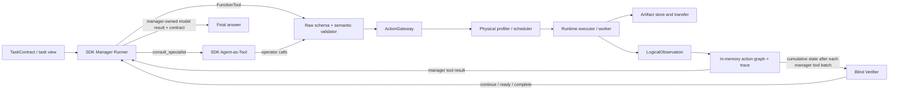

# InfraMAS current harness: source reconstruction

Audit baseline: `ee7166343539cf8696dfccdd21f71dd7d92839f6` on `harness-architecture-audit-v1` (13 October 2026). The two commits after the branch point changed only `research/real_benchmark_skills_v1`; all cited `src/infra_joint` files match `1ebec7986c555bb858d63e2df79c595cdd3748d2`. This is a source audit, not a new benchmark run.

The real entry is [`OpenAIAgentsNativeRuntime.run`](../../src/infra_joint/control/native_agents.py#L273-L450). It creates fresh `_NativeState` and a run namespace, builds Manager and bounded Specialist agents, then calls SDK `Runner.run` with a turn cap. Operator FunctionTools enter `_invoke_operator` through optional raw JSON Schema validation. That method maps request arguments into logical actions, checks phase, artifact visibility, semantic contract and budgets, records graph/trace, calls `RuntimeActionGateway.execute_batch`, and returns serialized typed observation. The gateway validates and reserves action/output IDs, observes infrastructure, prepares physical selection, executes, observes after, then marks successful outputs known ([`gateway.py`](../../src/infra_joint/control/gateway.py#L47-L113), [`physical.py`](../../src/infra_joint/control/physical.py#L520-L663), [`validation.py`](../../src/infra_joint/control/validation.py#L45-L113)). Physical placement is system-owned, not a Manager-selected worker or model ID.

The Specialist is an SDK `Agent.as_tool` wrapper. It receives only assigned artifact IDs and role instructions, runs a bounded nested loop, returns text plus produced artifact IDs, and grants those artifacts to the Manager ([`native_agents.py`](../../src/infra_joint/control/native_agents.py#L543-L678)). A Manager tool-result batch invokes the blind Verifier once when enabled. The Verifier receives all accumulated observations/actions, graph, produced-artifact metadata and remaining budgets, then returns `continue`, `ready_for_synthesis`, or `complete` ([`native_agents.py`](../../src/infra_joint/control/native_agents.py#L680-L891), [`verification.py`](../../src/infra_joint/control/verification.py#L21-L106)). A `complete` result selects the latest successful Manager-owned model result; final output is checked against that result and the task output contract. `ready_for_synthesis` restricts expansion tools until a later `continue` reopens evidence collection ([`native_agents.py`](../../src/infra_joint/control/native_agents.py#L903-L909), [`native_agents.py`](../../src/infra_joint/control/native_agents.py#L1340-L1366)).

## State ownership map

| State | Owner and enforcement | Persistence / limitation |
|---|---|---|
| Task and answer contract | `TaskContract`, `AgentTaskView`, system validators | Loaded anew per run; evaluator remains private. |
| Conversation and SDK tool items | Agents SDK `Runner` | SDK may accept sessions/RunState; this integration passes neither. New run starts a fresh SDK conversation. |
| Visible artifacts and per-agent ownership | `_NativeState.accessible`, `produced`, `actions`, `observations`; `SemanticActionValidator` | In memory. Generated artifact IDs are namespace-scoped. Semantic validator reserves IDs; successful output becomes known only on `complete_batch`. |
| Chronological trace | `WorkflowTraceRecorder` and configured sink | Event order and snapshots are durable if sink is; no loader reconstructs complete native state from trace. Trace parent IDs are chronological, not causal edges. |
| Execution graph | `ExecutionGrownGraph` | Append-only action history with explicit `depends_on` and artifact producer-consumer edges. It has no proposed pending suffix or implicit prompt-information edges. |
| Verifier phase/budget | `_NativeState`, `_verify_manager_batch`, `VerificationResult` | Program-enforced phase and limits; semantic sufficiency is an LLM judgment. `VerificationResult` has no candidate action ID. |
| Physical availability and selection | `PhysicalProfiler`, scheduler, `PhysicalExecutionService` | Current snapshot used at execution. Planner receives static capability classes and optional profile/feedback, not deployment identity or complete feasibility proof. |
| Materialized artifact bytes | Worker artifact stores | Content SHA and idempotent identical writes; metadata and blob written separately. Artifact store is not a conversation checkpoint. |
| Formal workflow plan | `SemanticWorkflowPlan`, `WorkflowRuntimeState`, `AdaptiveWorkflowExecutor` | A *separate* execution path has pending/running/completed and legal pending-only KEEP/PATCH. It is not the native Manager's live future plan. |

The formal path has an actual mutable pending plan, not merely an idea: [`workflow.py`](../../src/infra_joint/control/workflow.py#L32-L104) and [`workflow_validation.py`](../../src/infra_joint/control/workflow_validation.py#L143-L263) enforce versioned pending edits and immutable executed/running actions. [`adaptive_executor.py`](../../src/infra_joint/control/adaptive_executor.py#L91-L278) profiles the ready frontier and executes it. It does not yet give the SDK-native Manager a transactionally revisable future DAG or native-loop checkpoint. The legacy [`loop.py`](../../src/infra_joint/control/loop.py#L177-L453) is another custom execution loop; findings explicitly identify which path they concern.

Resource/cost state has several distinct owners. [`capabilities.py`](../../src/infra_joint/control/capabilities.py#L18-L82) reduces deployments to anonymous static model classes; optional [`_predecision_run_config`](../../src/infra_joint/control/native_agents.py#L452-L480) can add fresh resource-blind profiles to aware Manager turns. The Scheduler enforces actual feasible bindings when the action arrives. [`SpentCostLedger`](../../src/infra_joint/control/ledger.py#L26-L55) distinguishes measured and unknown receipts, counts confirmed versus unknown inference, and explicitly says work sums are not E2E. [`method_usage.py`](../../src/infra_joint/control/method_usage.py#L16-L45) measures SDK Manager/Specialist tokens where its optional wrapper is used and treats SDK zero usage as unknown. Verifier tokens are separately recorded by [`verification.py`](../../src/infra_joint/control/verification.py#L208-L242). A context estimate based on artifact bytes/image cost must not be called actual tokenizer usage ([`consequence.py`](../../src/infra_joint/control/consequence.py#L163-L189)).

Program-enforced controls include schema validation *when enabled*, semantic action validation, output namespace, visibility, budgets, phase, scheduler selection and answer-format checks. Instructions asking the Manager not to choose a worker/model and to obtain a successful `invoke_model` result are partly prompt-level and partly terminal-source enforcement. The SDK supplies model/tool iteration and Agent-as-Tool; InfraMAS supplies the physical gateway, Verifier, graph, terminal provenance rule and formal revision protocol.
